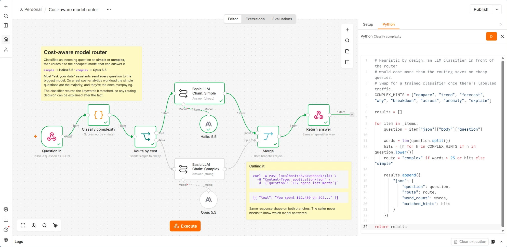

# Cost-aware model router

An [n8n](https://n8n.io) workflow that sends each question to the cheapest Claude model that can answer it.

**[View the live workflow →](https://ananmay1224.github.io/cost-aware-model-router/)**



## Why

Most "ask your data" assistants send every question to the biggest model. From building a natural-language assistant over a cloud cost warehouse, most questions are simple lookups ("EC2 spend last month"), and those are the ones that overpay. This workflow puts a free, deterministic classifier in front of the models. Simple questions go to **Claude Haiku 5.5**; only the complex ones go to **Claude Opus 5.5**.

## How it works

```
POST /webhook/cost-aware-model-router  {"question": "..."}
        │
        ▼
 Classify complexity   (Python Code node: word count + hint words)
        │
        ▼
   Route by cost ── simple ──▶ Basic LLM Chain: Simple  ◀── Haiku 5.5
        │                               │
        └──── complex ─▶ Basic LLM Chain: Complex ◀── Opus 5.5
                                        │
                                        ▼
                                      Merge ──▶ Return answer
```

Both branches return the same shape, and the response carries the routing decision with the answer:

```json
{
  "text": "I can't see your billing data, but EC2 spend is usually driven by...",
  "route": "complex",
  "word_count": 7,
  "matched_hints": ["why"]
}
```

A missing or blank question also returns an `error` field.

## Routing rule

A question is **complex** if either of these is true:

- it has **more than 25 words**, or
- any word **starts with** one of these hints:
  `compare`, `trend`, `forecast`, `why`, `breakdown`, `across`, `anomaly`, `explain`

Otherwise it is **simple**. Matching is by prefix on whole words, so "trends" and "explained" match but a hint buried inside an unrelated word does not. A missing or blank `question` routes to simple and adds an `error` field instead of failing.

Because `route`, `word_count` and `matched_hints` come back in every response, any routing decision can be explained from the response alone.

## Try it yourself

1. Run n8n locally with the [one-line setup](https://docs.n8n.io/deploy/host-n8n/install-options/one-line-setup).
2. In n8n, create a new workflow, open the **⋯** menu and choose **Import from File**, then select [`workflow.json`](workflow.json).
3. Open the **Haiku 5.5** and **Opus 5.5** nodes and attach your own Anthropic credential to each one.
4. **Publish** the workflow.
5. Call the webhook (the path is set in the **Question in** node):

```bash
curl -X POST http://localhost:5678/webhook/cost-aware-model-router \
  -H "Content-Type: application/json" \
  -d '{"question": "Why is my EC2 spend so high?"}'
```

`/webhook-test/...` is for runs triggered from the editor (click **Execute** first). `/webhook/...` is for the published workflow.

The webhook has no authentication, and the path above is public. If you expose n8n beyond localhost (for example through a tunnel), change the path and turn on authentication in the **Question in** node first. Otherwise anyone who finds the URL can spend your Anthropic credits.

## Limitations

- **This is a demo.** No billing data is connected. The models are told this and answer from general knowledge, naming the data they would need for a precise answer.
- **The classifier is a keyword heuristic.** It will misroute some questions. For example, "anomalies" does not start with "anomaly", and "comparison" does not start with "compare". That trade-off is deliberate: an LLM classifier in front of the router would cost more than routing saves on cheap questions.

## Roadmap

- Log every routing decision with its token cost per question.
- Measure answer quality on the cheap route, to catch questions that should have gone to Opus.
- Replace the heuristic with a trained classifier once there is labelled traffic.

## License

[MIT](LICENSE)
